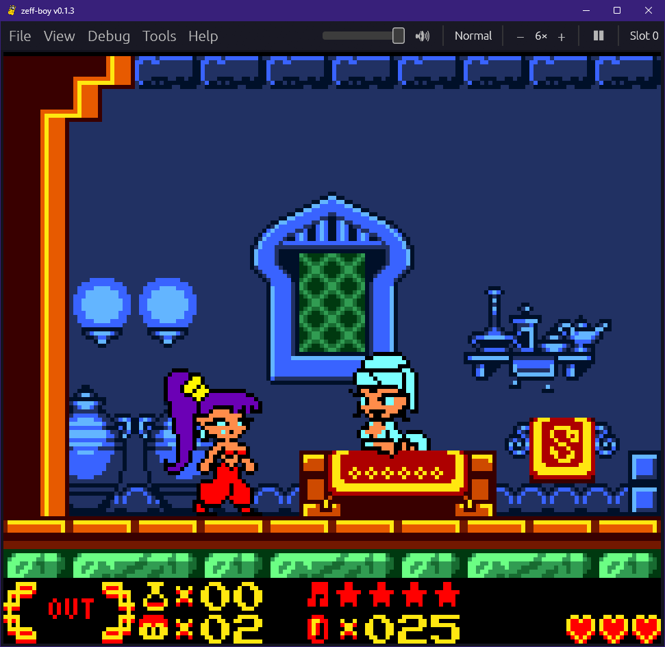
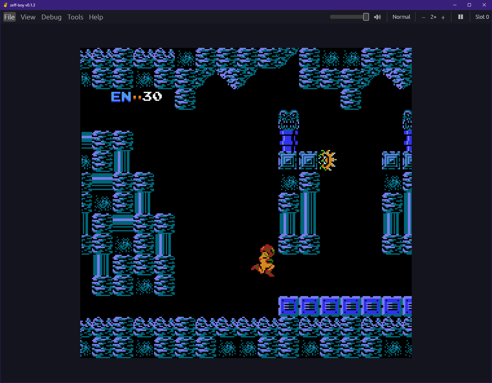
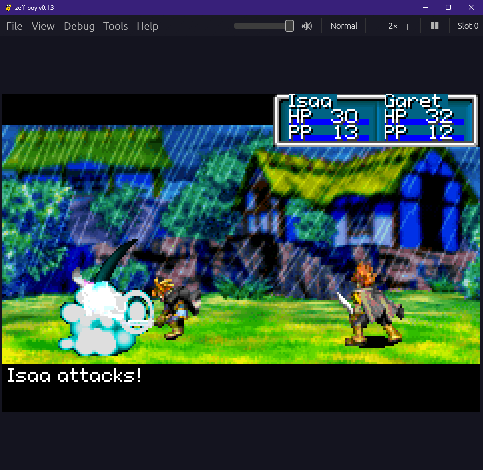
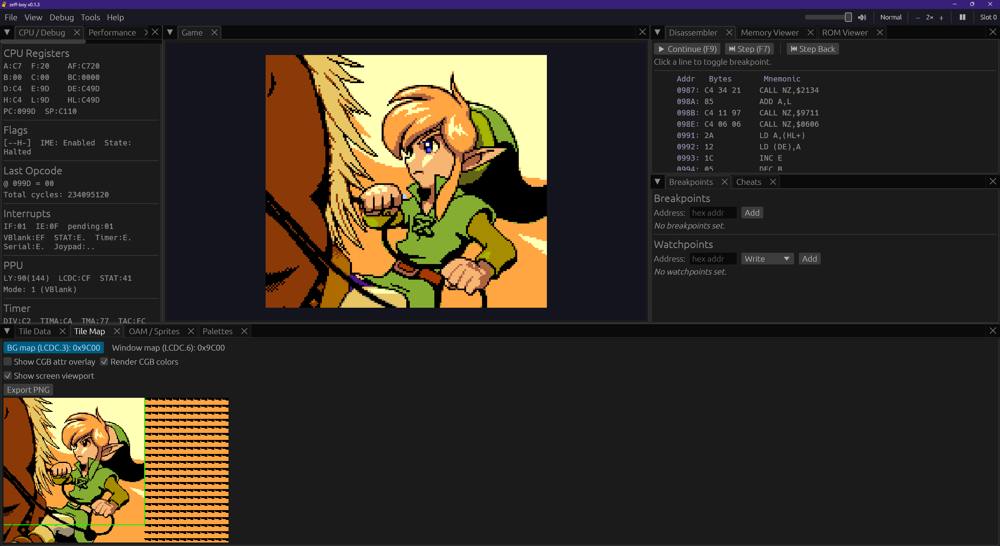

# Zeff-Boy

**Zeff-Boy** is a Game Boy, Game Boy Color, Game Boy Advance, NES, ColecoVision, PC Engine, WonderSwan, Sega 8-bit, and experimental Mega Drive emulator written in Rust.
I've mainly started this project to help me learn about low level programming and emulation.

Oh and I like making cool shit.

Web builds: [Nightly](https://zeffuro.github.io/zeff-boy/) · [Stable](https://zeffuro.github.io/zeff-boy/stable/).

Browser netplay is in Nightly under **Netplay** on the quickbar. Load matching `.nes`, `.sms`, `.sg`, `.pce`, `.ws` or `.wsc` ROMs, directly or from ZIPs. Use the same web build and share a Lobby invitation. Browser ZIPs must contain one ROM.

Experimental Mega Drive support loads `.md`/`.gen` cartridges and ZIPs, including recognized banked formats; `.bin` files need a recognized console header. NTSC-US/Japan/PAL, stereo audio, supported cartridge saves, save states, rewind and two selectable three/six-button pads are available (Settings > Emulation; reload after changing). Interlace and cartridge saves require Standard timing.

Earlier experimental Mega Drive save states using the ZMDSTATE format are incompatible with this version. Cartridge SRAM and EEPROM save data retain their format.

Debugging targets the primary M68000: paused register/memory edits, stepping, watchpoints, hit-count PC breakpoints, opcode history, full consumed-instruction tracing, symbols and Native ELF/DWARF source lines and guest calls with undo. Physical ROM breakpoints stop after opcode completion. SOUND inspection is read-only. Standard timing with concurrent SOUND supports passive instruction tracing and memory and 8-bit I/O watchpoints on eligible base cartridges. During normal execution, SOUND watchpoints stop after the current MAIN instruction completes. Cheats support raw work-RAM codes (`FFxxxx:VV` or `FFxxxx:VVVV`), physical ROM byte/word offsets and Game Genie (`XXXX-XXXX`, first 4 MiB). ROM cheats admit plain ROM, SRAM/EEPROM and SF001/SF002/SF004 up to 4 MiB, recognized 512 KiB Realtec, recognized LockOn configurations, SSF2 up to 8 MiB, recognized ExtendedSSF up to 128 MiB and plain TMSS ROM up to 4 MiB. Save hardware, mappers and TMSS require Standard timing. Eligible Standard SVP and Download profiles use ROM read masks. Physical ROM breakpoints exclude these two profiles. State loads retain the current cheat set; Native Libretro `.cht` lists can be imported.

Native replay is supported. Native TAS projects support fresh ordinary ROMs up to 4 MiB, direct or selected ZIP member, using NTSC-US/Standard, concurrent 48 kHz audio and two equal three- or six-button pads. MD shared-console netplay requires matching builds and fresh ordinary ROMs up to 4 MiB; it supports all three regions and both timing models, with 48 kHz audio and equal pad kinds. TAS/netplay exclude cartridge saves, firmware, modifications, cheats and serial devices. Headless TAS uses `--tas-verify PROJECT.ztas --tas-branch main --tas-export NEW.zrpl ROM`.

Sega CD/32X and service peripherals are outside this baseline. The libretro core accepts MD cartridges up to 4 MiB; TMSS and SVP are unavailable there. Headless options include `--md-region auto|ntsc|japan|pal`, `--md-controller 3|6`, `--md-timing standard|precise`, `--load-state FILE`, `--md-save-state-out NEW.mdstate` and `--replay FILE.zrpl` with matching region/timing/pad settings.

   


## Audio discovery

Audio Explorer finds supported music drivers, previews their tracks and exports
WAV audio and source assets. Support depends on the driver and ROM version.
Some entries are sound effects or hardware presets.

Scan a ROM or render a supported PSG VGM/VGZ capture:

```text
zeff-boy --audio-discover scan.json game.gb
zeff-boy --audio-discover scan.json capture.vgm --audio-export wav capture.wav --audio-song-offset 0 --audio-max-seconds 60
```

The experimental PSGlib and hUGEDriver exporters support specific driver builds:

```text
zeff-boy --audio-psglib streams.zip game.sms --psglib-rate 60 --psglib-auto
zeff-boy --audio-huge music.zip music.gb
```

See the [PSGlib](tests/fixtures/psglib) and [hUGEDriver](tests/fixtures/huge)
fixtures for supported inputs. Choose 50 or 60 Hz for PSGlib. Captured VGM playback
runs once. Loop markers are not repeated.

Capture and check native audio, or try a few input sequences automatically:

```text
zeff-boy --headless --max-frames 600 --audio-trace capture.zip --audio-dump native.f32 --input start@180-181 game.gb
zeff-boy --audio-capture-check playback.json capture.zip --audio-capture-reference-f32 native.f32 --audio-capture-wav capture.wav --audio-max-seconds 15
zeff-boy --audio-capture-sweep captures game.gb
```

Native captures support GB/GBC, base NES, Sega 8-bit/Coleco PSG, HuCard PSG and
ordinary WonderSwan audio. Captures record executed audio. They do not discover
unplayed songs. Output files and directories must be new. Run `zeff-boy --help`
for selection, duration, validation and corpus-report options.

## License

Licensed under either of:

* Apache License, Version 2.0 ([LICENSE-APACHE](LICENSE-APACHE) or http://www.apache.org/licenses/LICENSE-2.0)
* MIT license ([LICENSE-MIT](LICENSE-MIT) or http://opensource.org/licenses/MIT)

at your option.

Third-party components and their licenses are listed in
[THIRD_PARTY_NOTICES.md](THIRD_PARTY_NOTICES.md).

### Contribution

Unless you explicitly state otherwise, any contribution intentionally submitted
for inclusion in the work by you, as defined in the Apache-2.0 license, shall
be dual-licensed as above, without any additional terms or conditions.
